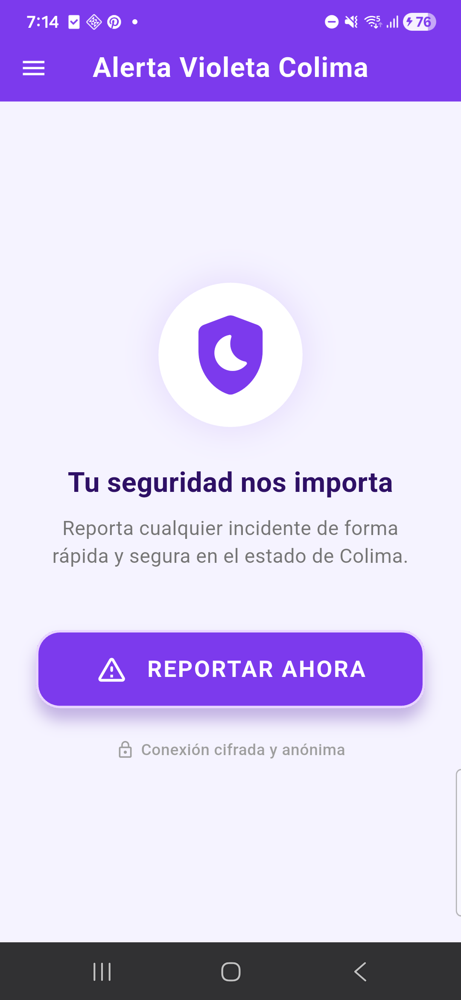
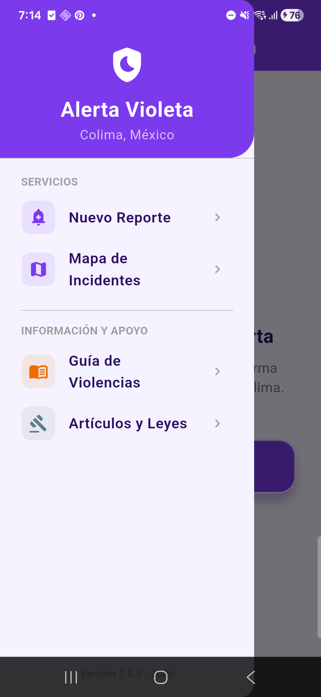
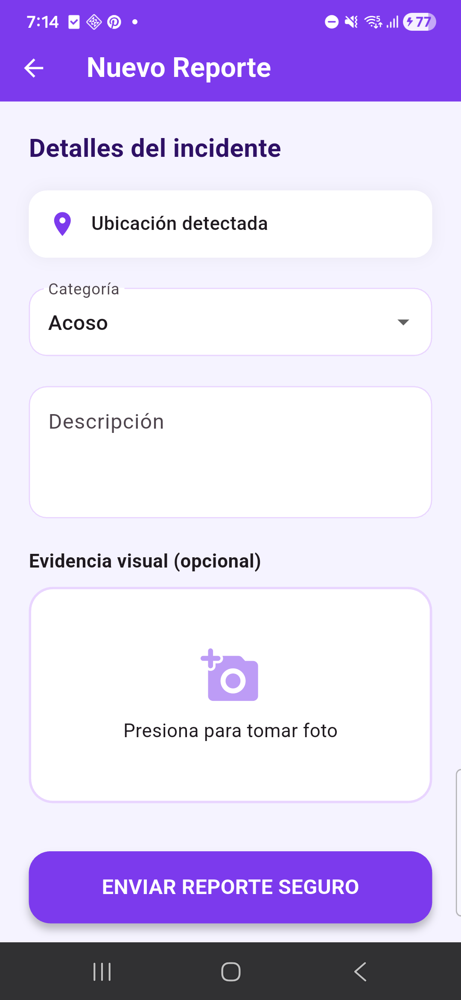
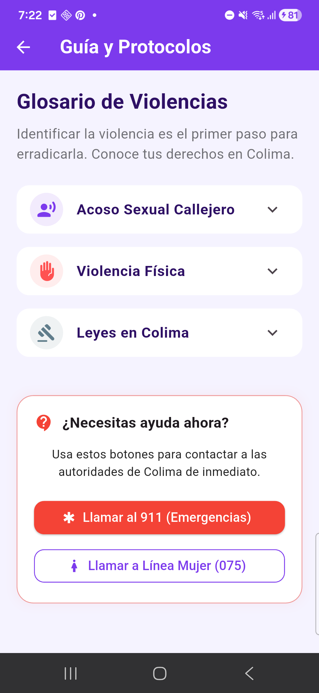

# Alerta Violeta Colima

> Este proyecto tiene dos partes: la **app móvil** (este repo) y la **página web + API**: [alerta-violeta-web](https://github.com/iGlitchlol/alerta-violeta-web) · [sitio en vivo](https://verduzco2.vercel.app).

Aplicación móvil hecha en **Flutter** para reportar incidentes de violencia de género en Colima, ver en un mapa dónde ocurren y encontrar información y apoyo.

## Capturas

<p align="center">
  
  
  
  
</p>

## Funcionalidades

- **Nuevo reporte**: toma la ubicación GPS del dispositivo y permite elegir una categoría (p. ej. acoso), escribir una descripción y adjuntar una foto con la cámara. El reporte se envía a una API REST.
- **Mapa de riesgo**: muestra en un mapa interactivo (OpenStreetMap / CARTO) los reportes registrados, con su categoría y fecha.
- **Guía de violencias**: información sobre acoso sexual callejero, violencia física y leyes en Colima.
- **Botones de emergencia**: llamada directa al 911 y a Línea Mujer (075).

## Tecnologías

- Flutter / Dart
- `geolocator`: ubicación GPS
- `image_picker`: cámara
- `flutter_map` + `latlong2`: mapa
- `http`: consumo de la API
- `url_launcher`: llamadas telefónicas

## Backend

La app consume la API `https://verduzco2.vercel.app/api/report` (función serverless en Vercel), que guarda y devuelve los reportes.
Código del backend y la página web: [alerta-violeta-web](https://github.com/iGlitchlol/alerta-violeta-web).

## Estructura

```
lib/
├── main.dart
├── screens/
│   ├── home_screen.dart     # Pantalla principal
│   ├── report_screen.dart   # Formulario de reporte (GPS, foto, categoría)
│   ├── map_screen.dart      # Mapa de incidentes
│   └── guia_screen.dart     # Guía, leyes y números de emergencia
└── widgets/
    └── drawer_menu.dart     # Menú lateral
```

## Cómo correrla

Requisitos: [Flutter SDK](https://docs.flutter.dev/get-started/install) 3.38+ y un dispositivo Android (o un emulador).

```bash
git clone https://github.com/iGlitchlol/alerta-violeta-app.git
cd alerta-violeta-app
flutter pub get
flutter run
```
